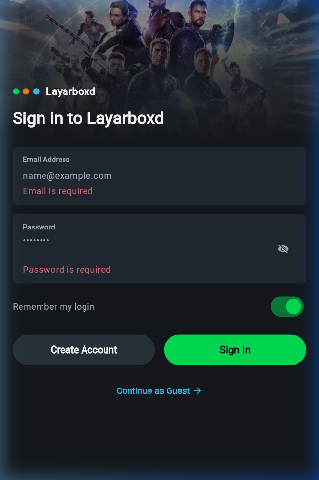
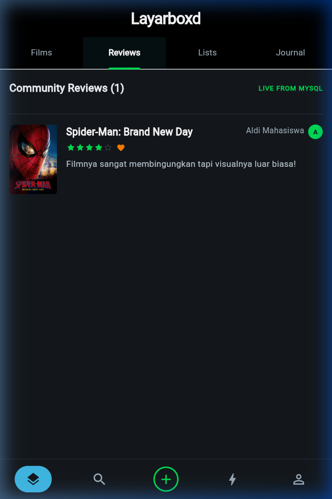
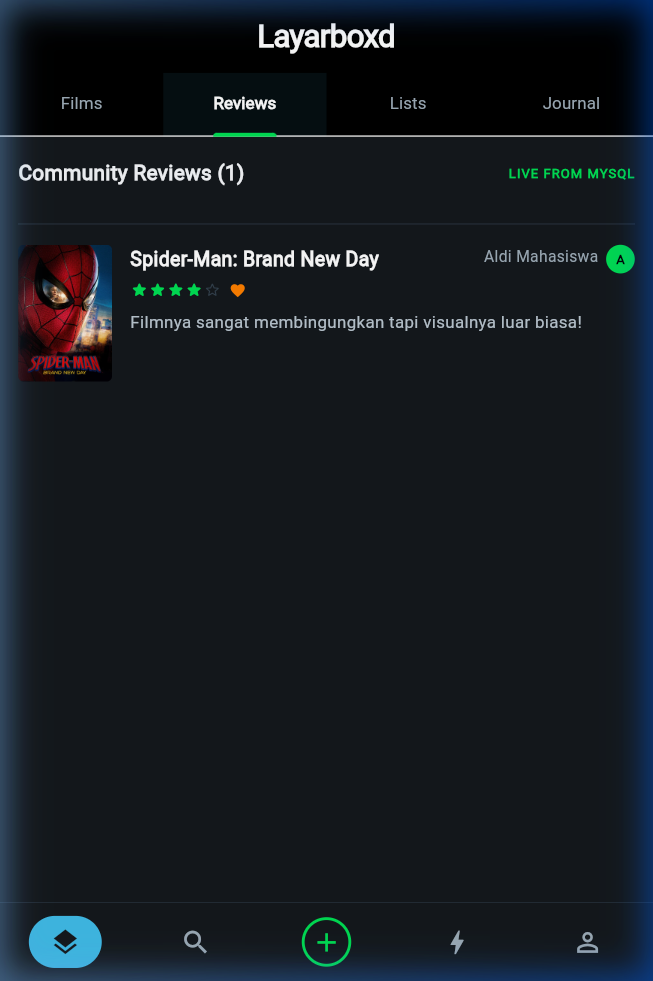
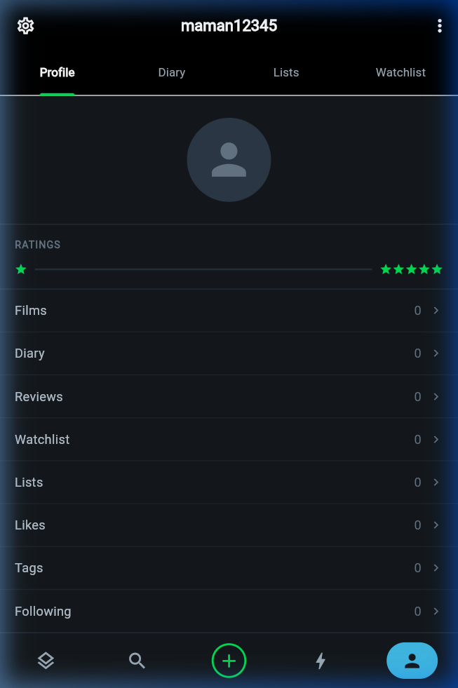
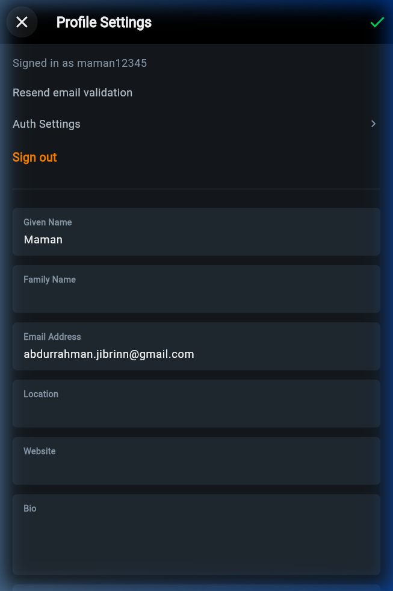
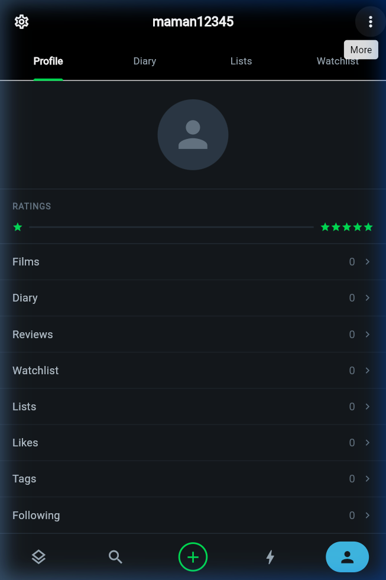

# Layarboxd

Layarboxd adalah aplikasi *mobile* pencatatan, *watchlist*, dan ulasan film.

## Anggota Kelompok
1. [Lizam Sabit Mafaiz] - [24051214106]
2. [Rizal Abid Alfarizi] - [24051214114]
3. [Farhan Putra Pratama] - [24051214115]
4. [Abdur Rahman Jibrin] - [24051214126]
5. [Achmad Amirul Mu'minin] - [24051214128]

## Tentang Aplikasi
* **Aplikasi Asli:** Letterboxd
* **Nama Plesetan:** Layarboxd
* **Frontend:** Flutter
* **Backend:** Node.js, Express.js
* **Database:** MySQL (via XAMPP) dengan Prisma ORM
* **Third-Party API:** TMDB (The Movie Database) API

---

## Panduan Menjalankan Proyek

Proyek ini terdiri dari Backend (Node.js/Express) dan Frontend (Flutter). Ikuti panduan di bawah ini untuk menjalankan aplikasi secara lokal.
Persiapan Awal
Buka aplikasi XAMPP lalu nyalakan (Start) modul Apache dan MySQL.
Pastikan database bernama `layarboxd_db` (tersedia di folder database) sudah tersedia di MySQL lokal.

1. Menjalankan Backend
Buka terminal atau Command Prompt, arahkan ke folder `backend`:
```bash
   cd backend
   ```
Instal semua dependensi (jika belum pernah dilakukan):
```bash
   npm install
   ```
Pastikan file `.env` sudah dikonfigurasi (berisi `DATABASE_URL`, `JWT_SECRET`, dan `TMDB_API_KEY`) *untuk file .env bisa dilihat di pengumpulan LMS*.
Jalankan server backend:
```bash
   npx nodemon server.js
   ```
Pastikan muncul keterangan bahwa server berjalan di port 3000.

2. Konfigurasi Jaringan Frontend
Buka terminal (CMD) di Windows, ketik `ipconfig` untuk melihat IP Address laptop (IPv4 Address).
Di VS Code, buka folder `frontend`, lalu cari file konfigurasi API di: `core/config/api_config.dart`.
Pastikan variabel `defaultLanUrl` sudah diubah menggunakan IP Address laptop tersebut.
Contoh: `static const String defaultLanUrl = 'http://192.168.1.5:3000/api';`

3. Persiapan Menjalankan Frontend
Buka terminal baru, arahkan ke folder `frontend`:
```bash
   cd frontend
   ```
Bersihkan cache dan unduh paket Flutter:
```bash
   flutter clean
   flutter pub get
   ```
4. Pilihan Menjalankan Aplikasi (Web / HP)
Bisa dipilih antara tiga opsi di bawah ini untuk menjalankan aplikasi Layarboxd:

Opsi A: Menjalankan di Web Browser (Google Chrome)
Opsi ini sangat cepat dan praktis untuk simulasi di laptop.
Pastikan Google Chrome sudah terinstal di laptop.
Pada terminal folder `frontend`, jalankan perintah:
```bash
   flutter run -d chrome
   ```
Aplikasi Layarboxd versi web akan otomatis terbuka di tab baru Google Chrome.

Opsi B: Menjalankan di HP (Perangkat Fisik Android)
Opsi ini digunakan untuk melihat dan menguji aplikasi langsung di layar smartphone.
Pastikan laptop (Server) dan HP penguji terhubung ke jaringan Wi-Fi/Hotspot yang sama.
Pastikan HP Android sudah mengaktifkan Developer Options dan USB Debugging.
Sambungkan HP ke laptop menggunakan kabel USB.
Pada terminal folder `frontend`, jalankan perintah:
```bash
   flutter run
   ```
Jika muncul prompt pilihan perangkat, pilih perangkat Android milikmu, dan tunggu hingga proses build selesai dan aplikasi terbuka di HP.

Opsi C: Menggunakan File APK (Tanpa Install Flutter)**
1. Buka folder `apk/` dan pindahkan *file* `Layarboxd-release.apk` ke HP Android.
2. Instal *file* APK tersebut di HP.
3. **PENTING:** Pastikan HP Android tersebut terhubung ke **jaringan Wi-Fi yang sama** dengan laptop yang sedang menjalankan Server Backend & XAMPP.
4. Buka aplikasi Layarboxd yang sudah terinstal.

---

## 📸 Pratinjau Tampilan & Hasil Pengujian

| Beranda Film Populer | Ulasan Komunitas (Live MySQL) | Quick Log Sheet |
| :---: | :---: | :---: |
|  |  |  |

| Halaman Profil Pengguna | Form Edit Profil | Profil Setelah Diperbarui |
| :---: | :---: | :---: |
|  |  |  |

